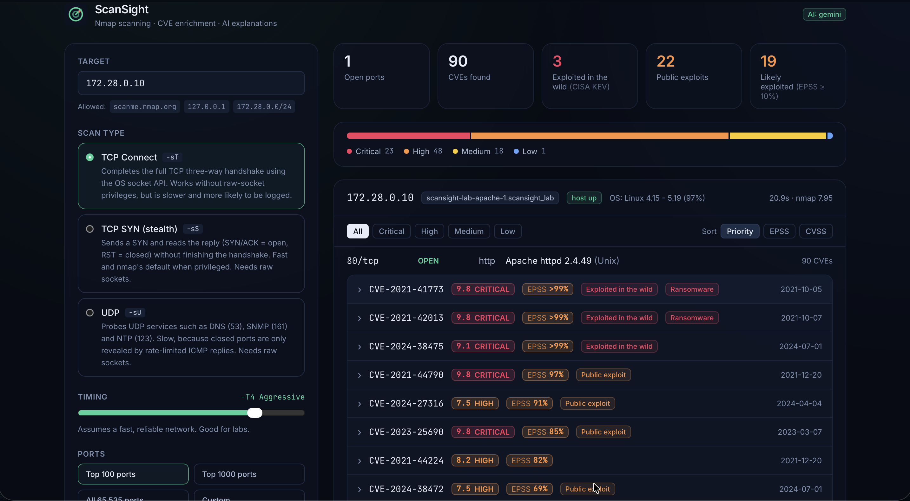
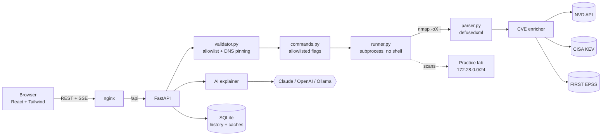

<div align="center">

# ScanSight

**Nmap scanning, CVE enrichment and AI explanations, in your browser.**

Enter a target, pick a scan type, timing and ports. ScanSight runs Nmap safely, matches every
detected service version to known CVEs, flags the ones attackers are actively exploiting, and
explains each one in plain language.




</div>

> ⚠️ **Only scan systems you own or have written permission to test.** ScanSight ships with a
> target allowlist and an isolated practice lab so you can try it safely.

---

## Features

- **Configurable Nmap scans.** TCP Connect, SYN and UDP techniques, timing templates
  `-T0`–`-T5`, top-100/top-1000/all/custom ports, plus version and OS detection.
- **Command preview.** See the exact `nmap` command before it runs, with every flag explained.
- **CVE detection.** Service versions (CPEs) are matched to CVEs with Nmap's `vulners` NSE script.
- **Enrichment.** Descriptions, CVSS vectors and CWE come from the **NVD API**, and actively
  exploited vulnerabilities are flagged from the **CISA KEV** catalog.
- **Risk-based prioritisation.** Each CVE gets an **EPSS** score (probability of exploitation in
  the next 30 days) from FIRST.org's free API. Findings sort by
  *exploited in the wild → EPSS → CVSS*, or by EPSS or CVSS alone. A free vulners API key adds
  public-exploit flags.
- **AI explanations.** Each CVE can be explained in plain language (what it is, impact, who is
  affected, how to fix it) using **Claude, OpenAI, any OpenAI-compatible API, or a local Ollama
  model**.
- **Live progress.** Scans run as background jobs and stream progress over Server-Sent Events.
- **Scan history** stored in SQLite.
- **Practice lab.** Deliberately outdated Apache, nginx and Redis containers on an isolated
  network.
- **Security built in.** Allowlist, DNS-rebinding protection, injection-proof command building,
  safe XML parsing and rate limiting (see [Security design](#security-design)).
- **Demo mode.** Replays a recorded scan, so a public demo never sends a packet.

## Architecture



**How a scan flows**

1. `POST /api/scans`: the target is validated, resolved **once**, and checked against the
   allowlist.
2. `commands.py` builds the argv from fixed options. User text never becomes a flag.
3. A background job runs nmap. `--stats-every` progress is parsed from the XML stream and
   pushed to the browser via SSE.
4. The XML is parsed into structured data, and `vulners` results become CVE records.
5. CVEs are enriched with EPSS scores (one batched request), CISA KEV status (refreshed daily) and,
   for the highest-priority ones, NVD details (cached for 7 days).
6. On request, the AI explainer turns a CVE into a plain-language briefing (cached per CVE).

## Quick start

```bash
git clone https://github.com/zainabthaa/scansight.git
cd scansight
cp .env.example .env          # optional: add an AI provider / NVD key
docker compose up --build -d
```

Open **http://localhost:8080** and scan the lab:

| Lab target | Service | Why it's interesting |
|---|---|---|
| `172.28.0.10` | Apache httpd 2.4.49 | CVE-2021-41773 / CVE-2021-42013 path traversal → RCE, both in CISA KEV |
| `172.28.0.11` | nginx 1.16.1 | CVE-2021-23017 resolver off-by-one, among others |
| `172.28.0.12` | Redis 5.0.7 | Outdated, and no authentication |

The lab network is `internal`, and its containers publish no ports, so they aren't reachable
from your LAN.

> CVE lookups need internet access: the `vulners` script queries vulners.com, and enrichment
> calls NVD, CISA and FIRST.

## Enabling AI explanations

Set `AI_PROVIDER` in `.env`:

| Provider | Settings | Notes |
|---|---|---|
| Anthropic Claude | `AI_PROVIDER=anthropic`, `ANTHROPIC_API_KEY=...` | Defaults to `claude-haiku-5-5` (fast and cheap) |
| OpenAI / compatible | `AI_PROVIDER=openai`, `OPENAI_API_KEY=...`, `AI_MODEL=...` | `OPENAI_BASE_URL` works with Groq, LM Studio, vLLM… |
| Ollama (local, free) | `AI_PROVIDER=ollama`, `OLLAMA_URL=http://host.docker.internal:11434` | Run `ollama pull llama3.1:8b` first |

The explainer is **grounded**: the prompt contains the official NVD description, CVSS and KEV
data, and the model is told not to go beyond them. Responses are requested as JSON and
validated, untrusted text is fenced off from instructions, and the model is told to stay
defensive (no exploit steps). Each explanation is cached per CVE and model, so repeat views
cost nothing.

## Configuration

All settings are environment variables (see [`.env.example`](.env.example)).

| Variable | Default | Purpose |
|---|---|---|
| `ALLOWED_TARGETS` | `scanme.nmap.org,127.0.0.1,172.28.0.0/24` | Hostnames / IPs / CIDRs that may be scanned |
| `ALLOW_ANY_TARGET` | `false` | Disable the allowlist (private instances only!) |
| `NMAP_PRIVILEGED` | `false` (`true` in Docker) | Enable SYN, UDP and OS detection |
| `SCAN_TIMEOUT_SECONDS` | `900` | Hard limit per scan |
| `MAX_CONCURRENT_SCANS` | `2` | Parallel nmap processes |
| `RATE_LIMIT_SCANS` / `_WINDOW_SECONDS` | `5` / `60` | Scans per client per window |
| `NVD_API_KEY` | — | 50 instead of 5 requests per 30 s ([free key](https://nvd.nist.gov/developers/request-an-api-key)) |
| `VULNERS_API_KEY` | — | Adds public-exploit flags to vulners findings ([free key](https://vulners.com/userinfo)) |
| `DEMO_MODE` | `false` | Replay a recorded scan instead of running nmap |
| `AI_PROVIDER` | `none` | `anthropic`, `openai`, `ollama` or `none` |

## Security design

A web front-end for a network scanner is an attractive target, so the backend treats every
input as hostile.

| Threat | Mitigation | Where |
|---|---|---|
| **Command injection** (`; rm -rf /`) | nmap runs via `create_subprocess_exec` with an argv list. No shell is involved. | `scanner/runner.py` |
| **Option injection** (`-oN /etc/passwd`, `--script=...`) | Targets starting with `-` are rejected. Users pick from allowlisted techniques, presets and toggles. Custom ports must match `^\d+(-\d+)?$`. | `scanner/commands.py`, `scanner/validator.py` |
| **Scanning third parties / SSRF** | Target allowlist. Single hosts only, no CIDR. Link-local (incl. cloud metadata `169.254.169.254`), multicast and reserved ranges are **always** blocked. | `scanner/validator.py` |
| **DNS rebinding (TOCTOU)** | The hostname is resolved once, **every** resolved IP must be allowed, and nmap receives the IP, not the name. | `scanner/validator.py` |
| **Malicious XML** (billion laughs, XXE) | Banners in nmap output come from the scanned host, so XML is parsed with `defusedxml`. | `scanner/parser.py` |
| **Resource abuse** | Per-client rate limits, a concurrency semaphore, a hard scan timeout, an output size cap, and refusing UDP all-port scans. | `core/ratelimit.py`, `core/jobs.py` |
| **Prompt injection** via CVE text | Data is wrapped in tags and labelled as untrusted. The output must match a JSON schema. | `ai/explainer.py` |
| **Excess privilege** | The container runs as a non-root user. Only the nmap binary gets `cap_net_raw`. | `backend/Dockerfile` |
| **Secrets in Git** | Keys come from `.env` (git-ignored). `.env.example` has no values. | `.gitignore` |
| **Supply chain / regressions** | CI runs ruff, **bandit** (SAST) and pytest on every push. | `.github/workflows/ci.yml` |

Many of these are covered by tests, e.g.
[`test_validator.py`](backend/tests/test_validator.py) and
[`test_commands.py`](backend/tests/test_commands.py).

## Project structure

```
scansight/
├── backend/
│   ├── app/
│   │   ├── scanner/            # ← everything Nmap-related
│   │   │   ├── commands.py     #   scan techniques, timing, ports, flag explanations
│   │   │   ├── validator.py    #   target parsing, allowlist, DNS pinning
│   │   │   ├── runner.py       #   async subprocess with timeout + progress
│   │   │   └── parser.py       #   nmap XML → models (incl. vulners output)
│   │   ├── cve/
│   │   │   ├── nvd.py          #   NVD CVE API 2.0 client (rate-limited, cached)
│   │   │   ├── kev.py          #   CISA KEV catalog
│   │   │   ├── epss.py         #   FIRST EPSS scores (batched, cached)
│   │   │   └── enricher.py     #   merges vulners + EPSS + KEV + NVD
│   │   ├── ai/
│   │   │   ├── providers.py    #   Anthropic / OpenAI / Ollama behind one interface
│   │   │   └── explainer.py    #   grounded prompt, JSON validation, caching
│   │   ├── core/
│   │   │   ├── jobs.py         #   background scan jobs
│   │   │   ├── database.py     #   SQLite: history + caches
│   │   │   └── ratelimit.py
│   │   ├── api/routes.py       # REST + SSE endpoints
│   │   ├── demo/               # recorded lab scan for DEMO_MODE and tests
│   │   ├── config.py
│   │   └── main.py
│   ├── tests/                  # pytest suite
│   └── Dockerfile
├── frontend/
│   ├── src/
│   │   ├── components/         # ScanForm, CommandPreview, ScanProgress, ScanResults, CveRow…
│   │   ├── hooks/useScanEvents.ts
│   │   ├── api/client.ts
│   │   └── types.ts
│   ├── nginx.conf
│   └── Dockerfile
├── docs/scan-techniques.md     # the Nmap concepts behind each option
├── docker-compose.yml          # app + isolated practice lab
├── .github/workflows/ci.yml
├── .env.example
├── SECURITY.md
└── LICENSE
```

## Testing

```bash
make test     # pytest: validator, command builder, parser, enrichment, explainer, API
make lint     # ruff + bandit + TypeScript typecheck
```

## Limitations

- **Version-based detection can produce false positives.** Distros backport fixes without
  changing version strings. Treat matches as leads to verify (see
  [docs/scan-techniques.md](docs/scan-techniques.md#limits-of-version-based-detection)).
- Without an NVD API key, enrichment is limited to 5 requests per 30 seconds. Results are
  cached, and only the 30 highest-scoring CVEs are enriched per scan.
- Single-process job queue. Scaling out would mean Redis plus a worker queue (e.g. ARQ/Celery).

## Roadmap

- [ ] Export reports as PDF / JSON / CSV
- [ ] Compare two scans of the same host (new ports, fixed CVEs)
- [ ] Scheduled recurring scans
- [ ] User accounts with per-user allowlists

## Legal & ethics

Port scanning without permission can be illegal and may violate your ISP's or cloud provider's
terms. This project is for education and for authorised security assessments. Nmap is a
trademark of Nmap Software LLC; this project is not affiliated with it.

## License

[MIT](LICENSE) © 2026 Zainab
